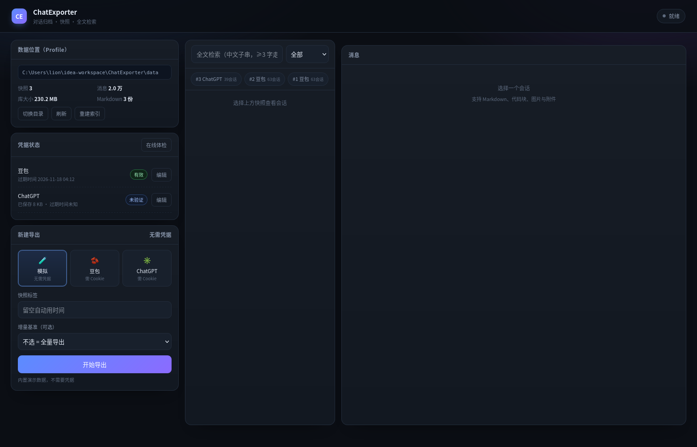

# ChatExporter

> 把散落在各家 AI 助手里的聊天记录，导出成**属于你自己的本地知识资产**。

[](https://github.com/wenliangliu05/chat-exporter/actions/workflows/ci.yml)


闭源 AI 助手的对话记录只存在别人的服务器里：换号、停服、涨价、删档，你都无能为力。
**ChatExporter** 用一个本地 Spring Boot 服务把它们导出来，落到 **Markdown + SQLite** 上，
再用 FTS5 建全文索引——几百万字变成可归档、可迁移、可检索的个人资产。

- 🧩 **平台可插拔**：豆包、ChatGPT 已实现，新增平台只需实现一个 `ChatPlatformAdapter`
- 📸 **快照式导出**：每次导出生成新快照，历史永不覆盖；支持基于旧快照的**增量导出**
- 🔍 **中文全文检索**：SQLite FTS5 + trigram 分词，2 万条消息 20ms 出结果
- 💬 **原样浏览**：聊天气泡 + 完整 Markdown（代码块 / 表格 / 图片）+ 向上滚动加载更早消息
- 🚀 **并发抓取**：RabbitMQ 每会话一条任务消息，可配置并发数，带限速与失败隔离
- 📊 **可度量**：每次导出记录耗时、会话数、消息数、有效字数

<!-- 截图：把运行后的界面截图放到 docs/screenshot.png -->


---

## 快速开始

### 环境

| 依赖 | 版本 | 说明 |
|---|---|---|
| JDK | 17+ | 只用 IDEA / Maven 也能跑，无需 Node、无需前端构建 |
| Maven | 自带 wrapper | `mvnw` / `mvnw.cmd` |
| RabbitMQ | 3.x / 4.x | **可选**：没装会自动退回本地线程池 |
| SQLite | 无需安装 | 由 `sqlite-jdbc` 内嵌，FTS5 已随驱动提供 |

### 启动

```bash
# Windows
set JAVA_HOME=C:\jdk-17
mvnw.cmd spring-boot:run

# macOS / Linux
JAVA_HOME=/path/to/jdk17 ./mvnw spring-boot:run
```

打开 <http://localhost:8082>（端口在 `src/main/resources/application.yml` 的 `server.port`）。

### ⚠️ 关于 `./data` 与 IDEA 工作目录

数据目录默认是 **`./data`**，即"进程的当前工作目录"，**不是**项目目录。这很容易踩坑：

- IDEA 运行配置默认 `WORKING_DIRECTORY = $MODULE_WORKING_DIR$`；
  如果你的 IDEA 项目是"打开父文件夹"创建的，模块目录可能就是父目录，
  于是 `./data` 落到了父目录下，**导出过也看不到数据**。
- 解决办法（本项目已内置）：启动时若发现当前工作目录不像项目根（没有 `pom.xml` / `.git`），
  会自动改成**按代码所在位置**向上定位项目根，再拼 `data`，并在日志里打印最终路径。
- 也可以在 `application.yml` 里写死绝对路径：`app.data-dir: D:/ChatVault`。

界面左上角始终显示**当前数据目录的绝对路径**，接不上数据时先看这里。

---

## Cookie 从哪里来

> Cookie 等同于账号登录态，**只在本地 `data/` 目录保存，已 gitignore，不会上传到任何地方**。

| 平台 | 步骤 | 必须包含的字段 |
|---|---|---|
| **豆包** | 打开 <https://www.doubao.com/chat/> 登录 → `F12` → Network → 筛 `recent_conv` → 该请求的 Request Headers → 整条 `Cookie` | `sessionid` |
| **ChatGPT** | 打开 <https://chatgpt.com> 登录 → `F12` → Network → 筛 `backend-api/conversations` 或 `api/auth/session` → 整条 `Cookie` | `__Secure-next-auth.session-token.0` 与 `.1`（长 Cookie 会被切段，两段都要）、`cf_clearance` |
| **模拟** | 无需凭据，内置 6 个会话用于演示与测试 | — |

保存位置（按优先级）：

```
请求体 cookie  →  data/cookie-<platform>.txt  →  data/cookie.txt  →  application.yml
```

界面「凭据状态」会显示每个平台的 **是否已保存 / 过期时间 / 剩余状态**；
豆包的过期时间从 `sid_guard` 解析（注意其中的 `|` 常被 URL 编码成 `%7C`），
ChatGPT 可点「在线体检」调 `/api/auth/session` 拿到 plan 与过期时间。

常见报错：

- **401** → 登录态过期，重新复制 Cookie
- **403（ChatGPT）** → Cloudflare 拦截。需保留 `cf_clearance`，且与浏览器同一网络出口；
  另外本项目强制 HTTP/1.1（Java 默认的 HTTP/2 指纹会被判为机器人）
- **712012002「不支持编码类型」（豆包）** → 请求头必须带 `Content-Type: application/json; encoding=utf-8`

---

## 架构

```
                        ┌──────────────────────────────┐
  浏览器 (原生 HTML/JS)  │  index.html：Profile / 会话 / 检索  │
                        └──────────────┬───────────────┘
                                       │ REST + SSE
                        ┌──────────────▼───────────────┐
                        │ controller/  Export · Query · │
                        │              Search · Profile │
                        ├───────────────────────────────┤
                        │ service/   ExportService      │  编排：列会话 → 派发 → 收尾
                        │            SearchService      │  FTS5 / LIKE 降级
                        │            ProfileService     │  路径、凭据、时效
                        ├───────────────────────────────┤
     RabbitMQ  ┌───────►│ executor/  SessionTask        │  每会话一条任务
   （可选）     │        │            SessionTaskConsumer│
                │        ├───────────────────────────────┤
                │        │ adapter/   ChatPlatformAdapter│  ★ 可插拔端口
                │        │   ├── doubao/  (im/chain/*)   │
                │        │   ├── openai/  (backend-api) │
                │        │   └── mock/    (测试/演示)    │
                │        ├───────────────────────────────┤
                │        │ repository/ Snapshot · Markdown│
                │        │             Schema (FTS5)     │
                │        ├───────────────────────────────┤
                │        │ config/ ProfileContext        │  运行时切换数据目录
                └────────┴───────────────────────────────┘
                                       │
                    data/  snapshot.db · markdown/ · assets/ · cookie-*.txt
```

### 三层模型

| 层 | 包 | 职责 |
|---|---|---|
| 工具 model | `adapter/` | 平台 API、Cookie、响应解析（**唯一知道某平台长什么样的地方**）|
| 业务 model | `domain/` | `Platform → Conversation → Message` |
| 持久化 model | `repository/` | SQLite 三表 + FTS5 索引 + Markdown 渲染 |

### 几个关键设计取舍

- **为什么不用 Hikari / Spring DataSource**
  → 需要"运行时切换数据目录"。DataSource 是启动时绑死的，所以由 `ProfileContext` 自己管
  `SQLiteDataSource`；SQLite 单写者，本来也不需要连接池。
- **为什么全文索引用 trigram**
  → 中文没有词边界，默认分词会把整句当一个 token。trigram 直接支持子串匹配，零外部依赖。
- **为什么消息要分页而不是一次全渲染**
  → 单个会话可达 1700+ 条，一次性生成几千个 DOM 节点会明显卡顿。改成"最新一页 +
  向上滚动加载 + DOM 上限"，行为与聊天软件一致。
- **为什么索引重建放到后台线程**
  → 2 万条建 trigram 索引约需 100 秒，放启动流程里会让应用迟迟不可用。

---

## 接口

| 方法 | 路径 | 说明 |
|---|---|---|
| POST | `/api/export/full` | 全量导出 `{platform,label,cookie?}` → `{jobId}` |
| POST | `/api/export/incremental` | 增量导出 `{platform,label,baseSnapshotId,cookie?}` |
| GET | `/api/export/jobs/{id}` | 任务状态 |
| GET | `/api/export/jobs/{id}/stream` | SSE 进度流 |
| GET | `/api/snapshots` | 快照列表（含耗时、字数）|
| GET | `/api/snapshots/{id}/conversations` | 会话列表 |
| GET | `/api/conversations/{rowId}/messages?before=&limit=` | 消息分页（游标 = 消息 id）|
| GET | `/api/search?q=&snapshotId=&platform=` | 全文检索 |
| GET | `/api/profile` | 数据目录、库大小、快照数、Cookie 状态 |
| POST | `/api/profile/activate` | 切换数据目录 `{path}` |
| POST | `/api/profile/cookie` | 保存 Cookie `{platform,cookie}` |
| POST | `/api/profile/check` | 在线体检 Cookie |
| POST | `/api/profile/reindex` | 后台重建全文索引 |

---

## 数据目录

```
<profile>/
├── snapshot.db          SQLite：snapshot / conversation / message / message_fts
├── markdown/
│   └── snapshot-<id>/   每个会话一份 .md（含角色、思考块、工具调用）
├── assets/              预留：图片与附件
├── cookie-<platform>.txt
└── logs/
```

`data/` 已在 `.gitignore` 中。**导出数据、Cookie、日志都不会进入 Git。**

---

## 已知限制

- 图片/附件目前只记录链接，不下载二进制；链接过期后会显示占位，需要重新导一次
- 增量导出以「会话为单位」探测：仍会对每个会话发一次请求确认有无新消息
- 单个会话的增量锚点是消息序号/时间戳，若平台侧删改历史，可能出现重复或遗漏
- ChatGPT 的对话是树结构，当前只导出 `current_node` 这一条主线（不含编辑分支）
- 免费账号的会话数量受平台限制，导出条数即账号实际可见范围

## Roadmap

- [ ] 附件落盘（`assets/`）+ Markdown 本地链接
- [ ] n-gram 倒排 + embedding 向量检索（语义搜"意思相近"）
- [ ] 更多平台适配器（Claude / Gemini）
- [ ] 快照 diff 视图（这次比上次多了哪些对话）

---

## 开发

```bash
mvnw.cmd test              # 单元/集成测试：使用 mock 适配器，无需网络与凭据
mvnw.cmd -DskipTests package
```

CI（GitHub Actions）跑的就是 `mvnw test` —— 只用 `mock` 适配器，**不联网、不需要任何 Cookie**。

## License

[MIT](LICENSE)
